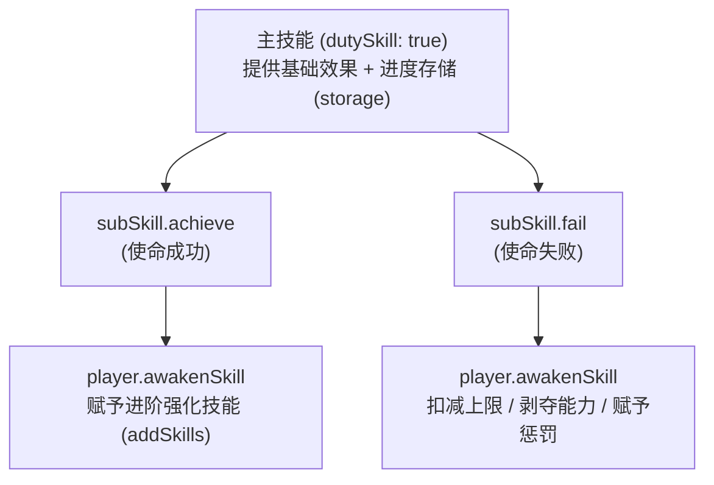
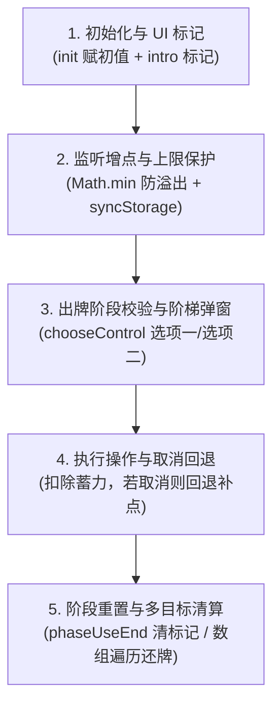

# 开发《无名杀》武将扩展

⚠️ **动手前必读**：本 skill 中的每条约定都来自源码实证。**不要凭三国杀桌游常识或旧版无名杀经验编写**——新版引擎已废弃多个旧写法（见"过时写法"）。

## 0. 项目定位

**工作目录 = 《无名杀》源码仓库根**（即包含 `apps/core/noname` 的目录，本 skill 所在仓库）。

> 脚本用 `process.cwd()` 自动向上查找仓库根，因此无需关心绝对路径。

- 源码核心：`apps/core/noname/`
- 扩展目录：`apps/core/extension/<扩展名>/`
- 武将包目录：`apps/core/character/<包名>/`
- 事件系统文档：`docs/YRD/`（自顶向下 23 篇：00~19 + 3 篇附录，含源码行号）
  > 17 篇为**打包与构建**（扩展产物在哪、`pnpm build` 做了什么、各端怎么打包）。
  > 18 篇为**安卓打包实战**（JDK 21 硬校验、Capacitor 同步三件事、签名与 SAF）。
  > ℹ️ 该目录属于**《无名杀》仓库本体**，不由本技能包安装。
  > 若目标仓库缺 `docs/YRD/`，说明尚未补充这批文档，此时跳过文档步骤、
  > 改用 `docs/game-event/`、`docs/lib-skill-format.md`，或直接用检索工具找参考实现。
- **模板库：`docs/YRD/templates/`（位于《无名杀》仓库，非本技能包）**
  > ⚠️ 其中源码行号以 `apps/core` **1.11.4.1** 为准。在 1.11.7 上实测 183 处引用
  > **0 处行号越界**，仅少数位置轻微位移。跳转对不上时按**符号名搜索**即可。
- **技能检索工具：`scripts/`（在 6700+ 个已有技能中找参考实现）**

## 1. 标准工作流

### UI 文档位置约定

当前《新宇杀-UI》项目的开发阶段、扩展 API、布局、动画、参考分析、截图与验收附件，归档到 `packages/extension/新宇杀-UI/docs/`，入口为其中的 `README.md`。无名杀 UI 引擎通用 API、DOM、事件、联机及生命周期机制继续放在仓库根 `docs/`。混合主题拆分后相互链接，不维护重复正文；构建输出 `apps/core/extension/新宇杀-UI/docs/` 不能手改。后续新增／迁移文档必须遵循仓库 `AGENTS.md`，并同步索引、知识库链接与脚本输出路径。

> **核心原则：先查知识库，再检索参考实现，最后从模板改写。不要从零编写技能。**

1. **明确需求**：技能的语义是什么？（何时触发、做什么、有无代价）
2. **🔍 检索**（**必做第一步**）：

   ```bash
   cd .agents/skills/noname-general-extension/scripts
   node skill-search.mjs search "<用功能语义描述，别用技能名>"
   ```

   检索会**自动先查知识库**（📘 区块，带指纹校验）再查技能索引（🔍 区块）：
   - 知识库命中 → 直接采用已沉淀的结论，**无需重复检索**
   - 知识库失效 → 显示警告并自动回退到索引检索
   - 从候选里挑 1-2 个最接近的，`node skill-search.mjs show <技能ID>` 查看实现
   - 不够贴合时：`node skill-search.mjs similar <技能ID>` 找结构类似的

3. **📘 沉淀结论**（开发完成后必做）：

   ```bash
   node skill-search.mjs learn \
     --title "简短标题" \
     --body "结论内容" \
     --kind pattern \
     --keywords "关键词1,关键词2" \
     --from <参考的技能ID>
   ```

   - `--from` 会记录**证据指纹**，源码变动时该知识自动标记失效，不会误导后续开发
   - `--link <文档路径>` 指向**已成篇的文档**（相对项目根），正文只写结论摘要：
   
     ```bash
     node skill-search.mjs learn \
       --title "打包与扩展产物（索引）" \
       --body "结论摘要…细节见文档" \
       --kind fact --keywords "打包,构建,extension,产物" \
       --link docs/YRD/17-build-and-packaging.md
     ```
   
     一时无法定型为文档的结论用 `--from` 绑源码；已经写成文档的用 `--link` 指向它，
     **不要在两处重复长篇内容**（会失同步）。两者可同时使用。
   - **每次开发都应该沉淀至少 1 条**，让知识库持续增值

4. **查模板**：从 `docs/YRD/templates/templates/` 选最接近的模板（11 类）。
5. **查文档**：机制不清楚时读 `docs/YRD/` 对应篇章（带源码行号可跳转核对）。
6. **写代码**：结合「知识库/参考实现」与「模板」改写 `character/skill.js`，同步补 `translate.js`。
7. **🔧 注册扩展**（**写完必做，否则游戏里看不到**）：

   ```bash
   cd .agents/skills/noname-general-extension/scripts
   node register-extension.mjs fix                  # 先修复被游戏内「制作扩展」覆盖的文件
   node register-extension.mjs guideall --enable    # 批量登记 + 启用
   ```

   把输出的脚本粘贴到**浏览器 Console**（F12），然后 F5 刷新。

8. **✅ 静态验证**（**写完必做**）：

   ```bash
   node verify-skill.mjs --pack <扩展名>     # 查悬空引用、缺描述、编码等问题
   ```

   详见下节「技能验证」。

9. **人工验证**：游戏内启用扩展 → 选将 → 实际发动技能。
   **静态验证通过 ≠ 技能能用**，触发时机/UI 流程只能实机确认。

### ★ 技能验证

验证分两层，**任何一层都不能替代另一层**。

#### 第一层：静态验证（可自动化，30 秒）

```bash
node verify-skill.mjs                      # 验证全部自建扩展
node verify-skill.mjs --pack 英雄杀RE       # 只验证一个扩展（推荐）
node verify-skill.mjs --skill yxsre_fenglang
node verify-skill.mjs --json               # 机器可读
```

**能查出**：

| 级别 | 检查项 | 说明 |
|------|--------|------|
| ✗ 错误 | 武将悬空引用 | 武将 `skills:[...]` 里写了不存在的技能 ID —— 选将能看到但技能无效 |
| ✗ 错误 | 源文件缺失 | 索引过期，需 `rebuild` |
| ⚠ 警告 | 技能缺描述 | 无 `<id>_info`（内部子技能、`_` 开头的不报） |
| ⚠ 警告 | 编码异常 | 文件非 UTF-8，游戏内会乱码 |
| · 提示 | 描述/实现不一致 | 描述里的数字在实现段中找不到，可能改了实现忘改描述 |
| · 提示 | 子技能未挂载 | 与父技能同文件、父技能确实用 `group` 挂载，但没列出它 |

**退出码**：有错误返回 1，可用于 CI/脚本串联。

**设计原则：只报能确证的问题。** 所有判据都经过真实代码验证 ——
例如「缺描述」会先排除被 `group` 引用的子技能、`_` 前缀的隐藏技能、
`<父技能ID>_<后缀>` 形式的派生技能，避免刷出一堆假警告。

#### 第二层：实机验证（**不可省略**）

静态验证**查不到**这些，必须人工在游戏里确认：

- 技能**是否真的触发**（时机名写错、`filter` 恒返回 false 都不会被静态检查发现）
- UI 询问流程能否正常弹出与结算
- AI 是否会使用该技能
- 数值平衡

启动游戏：

```bash
pnpm -F noname dev                                          # http://127.0.0.1:8081/
pnpm -F @noname/fs dev --debug --dirname=../../apps/core    # 8089
```

> ⚠️ 两个服务都要开。Vite/esbuild 需要创建子进程，若在受限沙箱中运行会报
> `spawn EPERM`，需放宽权限。
> **这是管道通信被拒，不是临时目录问题**——改 `TEMP` 无效，直接放宽该次命令的权限即可。
> 打包（打安装包）遇同类问题的完整对照见 §11.5。

> ⚠️ **端口以 `apps/core/vite.config.ts` 为准**（该文件里是唯一的真相）。
> 实测 1.11.7：客户端 **8081**、文件服务 **8089**。
> 若与本处不符，说明仓库改过配置，按 config 文件为准。

**为什么不能无头测试？** 实测过：`apps/core/noname` 下 27 个 `.ts` 含尖括号类型断言
（Node 的 type-stripping 不支持），且依赖 `.vue` 单文件组件，脱离 Vite 无法加载核心。
详见知识库 `kb-headless-testing-limits`。

#### 改技能后的完整验证顺序

```bash
node verify-skill.mjs --pack <扩展名>   # 1. 静态验证
node skill-search.mjs rebuild           # 2. 重建索引（否则 locate 行号是旧的）
node verify-skill.mjs --pack <扩展名>   # 3. 重建后再验一次（行号已更新）
# 4. 游戏内实机确认
```

### ★ 修改已有技能（不同于新建）

用户说「改一下 XX」时，**不要凭印象找文件**。一条命令拿到全部定位信息：

```bash
node skill-search.mjs locate <技能ID或中文名>
```

输出包含改一个技能所需的全部坐标：

| 区块 | 用途 |
|------|------|
| ① 技能实现 | `文件:起始行-结束行` —— 改逻辑 |
| ② 技能描述 | 描述原文 + `文件:行号` —— 改文案（**在 translate.js 或 extension.js，不在 skill.js**） |
| ③ 所属武将 | 哪些武将引用此技能、各自体力、定义位置 —— 评估影响面 |
| ④ 结构特征 | 触发时机、关键 API、子技能 —— 判断改动风险 |
| ⑤ 同包技能 | 同包其余技能 —— 找参照写法 |

**三条硬性纪律**：

1. **改描述 ≠ 改实现**。描述文本在 `translate.js` 的 `<id>_info` 字段（本体）或
   `extension.js` 的同一位置（单文件扩展）。`locate` 会直接给出描述所在行号。
2. **中文名可能重名**。如「天妒」有 4 个（`tiandu` / `sbtiandu` / `nagisa_tiandu` / `yxsre_tiandu`）。
   `locate` 遇到重名会**列出全部候选让你选**，绝不替你猜 —— 猜错会改错文件。
3. **改完要重建索引**：`node skill-search.mjs rebuild`，否则下次 `locate` 的行号是旧的。

改完实现后，**同步检查描述是否需要更新**（描述与实现不一致是常见缺陷来源）。

### ⚠️ 两个必知的机制陷阱

**陷阱一：写了扩展目录 ≠ 游戏里能看到**

扩展必须被登记到配置的 `extensions` 数组才显示（定位 `init/index.ts` 的 `getExtensionList`）。**当前 1.11.7 的 `loadConfig` 强制使用 IndexedDB 的 config store，不能靠写 `localStorage["noname_0.9_config"]` 配置新客户端。** 优先使用内核 `?importExtensionName=<扩展名>` 登记，或在客户端经 `game.promises.saveConfig` 保存；服务端文件修改不能替代客户端配置。

旧版 localStorage 内核的办法（`register-extension.mjs guideall`；当前 1.11.7 不采用这一写入方式）：
- 生成一段 Console 脚本，直接写 `localStorage`
- 脚本**顺带开启「自动导入扩展」**——之后新增扩展会被自动发现，**只需做一次**

**陷阱二：游戏内「制作扩展」会覆盖手写文件**

该功能（选项→扩展→制作扩展）会**无提示覆盖**同名扩展的 `extension.js`、`info.json`、`README.md`，生成空白模板。

| 症状 | 扩展能打开，但选将界面找不到武将包 |
| 原因 | 模板的 `precontent` 是空函数，不会 `import` 武将包 |
| 数据 | ✅ `character/` 目录**不会被删除**，武将数据仍完好 |
| 修复 | `node register-extension.mjs fix`（自动重建 extension.js） |

> **新建扩展请手动复制目录结构**（参考 `apps/core/extension/英雄杀/`），不要用游戏内的「制作扩展」。

### 检索与知识库示例

```bash
# 检索（自动先查知识库）
node skill-search.mjs search "摸牌阶段多摸一张牌"
node skill-search.mjs search "viewAs 将一张牌当杀使用"
node skill-search.mjs search "判定 红色黑色"        # 会命中已沉淀的判定写法

# ★ 修改已有技能：一站式定位
node skill-search.mjs locate 天妒                  # 也支持中文名（同名会列出候选）
node skill-search.mjs locate yxsre_fenglang

# 查看实现
node skill-search.mjs show drlt_jieying
node skill-search.mjs similar biyue

# 静态验证（写完技能后）
node verify-skill.mjs --pack <扩展名>    # 查悬空引用/缺描述/编码

# 沉淀结论（开发后）
node skill-search.mjs learn \
  --title "令角色放弃摸牌用 changeToZero" \
  --body "trigger.changeToZero() 令 num=0 且 numFixed=true" \
  --kind pattern --keywords "放弃摸牌,changeToZero" --from <技能ID>

# 知识库管理
node skill-search.mjs kb list      # 全部条目（含失效状态）
node skill-search.mjs kb check     # 只看失效的
node skill-search.mjs kb stats     # 统计
node skill-search.mjs kb forget <id>   # 移除

# 知识库体检（结构/指纹/引用/检索性/矛盾/未完成标记）
node kb-lint.mjs                   # 常规体检
node kb-lint.mjs --strict          # 有错误时退出码 1（可挂提交前）
node kb-lint.mjs --verbose         # 附全部条目指纹状态

# 扩展注册（写完扩展后必做）
node register-extension.mjs status       # 检查注册状态
node register-extension.mjs fix          # 修复被覆盖的 extension.js
node register-extension.mjs guideall --enable   # 批量登记 + 启用

# 迁移到其他机器（换电脑/换仓库时）
node migrate-skill.mjs pack               # 打包（约 120 KB，不含索引）
node migrate-skill.mjs check              # 迁移后自检
node build-index.mjs                      # 新机器上重建索引
```

> ⚠️ 索引需在源码变更后重建：`node skill-search.mjs rebuild`
> 详见 `scripts/README.md`。
>
> **迁移到其他机器**：只拷 6 个脚本 + `knowledge-base.json` + `SKILL.md`（约 120 KB），
> **不要拷 `skill-index.json`**（里面硬编码了原机器路径），到新机器后跑一次 `build-index.mjs` 即可。

### 启动开发环境

```bash
# 两个服务需同时运行
pnpm -F noname dev                                          # Vite 8081
pnpm -F @noname/fs dev --debug --dirname=../../apps/core    # 文件服务 8089
```

访问 `http://127.0.0.1:8081/`

> 首次安装依赖需联网：`pnpm install`。若 `@esbuild/win32-x64` 缺失导致启动失败，在 `apps/core` 下重新 `pnpm install`。
>
> **依赖链接残缺**（实测常见）：`pnpm install` 若在中途报
> `ERR_PNPM_SYMLINK_FAILED ... Maximum call stack size exceeded`（多发于 `apps/mobile`
> / `apps/electron`），**其余包的依赖链接也会跟着残缺**，表现为启动时报
> `Cannot find module 'avvio'`（packages/fs）或 `'rollup'` / `'esbuild'`（apps/core）。
> 修复：对报错的包单独强制重装 ——
>
> ```bash
> pnpm install --filter=@noname/fs --force
> pnpm install --filter=noname --force
> ```
>
> `apps/mobile`、`apps/electron` 仅打包用，浏览器开发模式不需要它们。

## 2. 扩展目录结构

**联机 UI 专用扩展（Vue 源码包）**：使用 `packages/extension/<名称>/` 为源码、`apps/core/extension/<名称>/` 为构建产物；扩展要显式 `connect:true`。`precontent/content/arenaReady` 应共用单例与一次自动初始化，避免用户回退后被后续加载回调重新启用。`message.client.reinit` 返回时异步重建可能尚未完成，结合原生 DOM 变化重新装配。原生 CSS 会将普通 div 绝对定位，Vue 宿主必须显式宽高。已在项目 `docs/online-ui-p1.md` 记录实现与验证；纯 UI 扩展无需添加空武将包，也不适用 `verify-skill --pack` 的武将技能验收。

**不要给网络按源码传输的函数套闭包包装。** 当前内核用 `Player.send(game.over, ...)` 将结算函数发送到客机；若把 `game.over` 替换成捕获 `original` 的函数，客机重建函数后会报 `original is not defined`。UI 跟踪结算使用 `lib.onover` 与 DOM 观察，保留原函数对象。其他适配点也先检查是否作为函数参数发送。

**真实选择输入必须保留窗口冒泡清理。** 直接 `ui.click.card/control.call(node)` 会漏掉 `ui.click.window` 对 `_status.clicked` 的清理，下一次输入可能失效。对原始 Card／Player／Control 派发冒泡 click／touchend，保留 native custom、技能备份／取消与联机回传；触屏用原生 TouchEvent。按当前本地事件、候选节点和请求版本拒绝旧操作；隐藏候选不能从 link／textContent 推断身份。真实房间测试还须等待房主端 client.inited，席位出现不等于异步 init 完成，否则 gameStart 广播会跳过该客机。通用原理见项目 `docs/YRD/15-ui-development.md` §12，实现和验证见 `packages/extension/新宇杀-UI/docs/online-ui-battle-interaction.md`。

**独立 UI 预览先控制渲染负载。** `ResizeObserver` 只收集尺寸，按帧去重发布，卸载取消待处理帧；Vite 库模式显式替换 `process.env.NODE_ENV` 并在真实浏览器验证。装饰骨骼可离线生成固定帧，运行页不创建 WebGL；素材必须看纹理核对，图集名不等于显示内容，负裁切偏移应保留全部像素。验证要覆盖无运行时骨骼请求、连续切场景、浏览器返回、弹窗焦点及滚动区最后一张牌。项目实证见 `docs/online-ui-p2-reference.md`；这类项目隐患不能直接等同于操作系统黑屏根因。

**小型图集流光可使用 CSS 阶梯帧动画。** 先恢复每帧旋转、裁切及相同透明留白，再横向拼接，以 `steps(帧数)` 播放背景位置；不能按可见像素边界裁紧各帧，否则光圈跳动。页面隐藏、离开视口或展示弹窗时暂停，切场景清理可见性监听；尊重低动态偏好，不用逐帧 JS 定时器。验证实际像素变化与暂停后位置稳定，参考 `docs/online-ui-lamps.md`。

```
apps/core/extension/我的扩展/
├── extension.js          ★ 必需：必须 export type 与 default
├── info.json             ★ 必需
├── main/
│   ├── precontent.js     ★ 必需：import 武将包
│   └── content.js        可选：rank/config 后处理
├── character/
│   ├── index.js          ★ game.import("character", fn)
│   ├── character.js      武将定义
│   ├── skill.js          技能定义
│   ├── translate.js      翻译（武将名/技能名/技能描述）
│   ├── intro.js          可选
│   ├── sort.js           可选：分组排序
│   ├── characterFilter.js 可选
│   ├── dynamicTranslate.js 可选
│   └── voices.js / pinyin.js  可选
├── image/character/<武将ID>.jpg     立绘
└── audio/skill/<技能ID>.mp3         配音
```

**完整模板见** `docs/YRD/templates/`（02~09 号文件可直接复制）。

## 3. 三个硬性约定

### ① extension.js 必须导出两个东西

```js
export let type = "extension";     // 引擎校验类型
export default extensionPackage;   // 扩展主体
```

依据：`apps/core/noname/init/import.ts:72-77`

**迁移拆分模块入口时，要保留 ESM 导入与辅助函数。** `node --check` 不能发现调用处的未定义变量。已验证 `connect:false` 只在后续装配阶段过滤 content，precontent 仍会先执行；不能据此跳过入口依赖检查。应在武将包合并后核对 character、skill、translate、characterIntro、characterTitle，再验证立绘路径。事故与验证记录见项目 `docs/yxsre-extension-loading-fix.md`。

### ② precontent 是引入武将包的唯一时机

```js
// main/precontent.js
import "../character/index.js";                       // 触发 game.import
export function precontent(config, pack) {
    lib.translate.我的扩展_character_config = "我的扩展";
}
```

### ③ 武将包入口格式

```js
game.import("character", function () {
    return {
        name: "mypack",        // ⚠️ 扩展内此值会被强制覆盖为扩展文件夹名
        character: { ... },
        skill: { ... },
        translate: { ... },
    };
});
```

⚠️ **`name` 覆盖陷阱**：`apps/core/noname/init/loading.ts:269` 会执行 `content.name = extension[0]`，所以扩展内武将包的 `name` **永远等于扩展文件夹名**，写什么都无效。因此 `characterSort` 的内层键应与扩展目录名一致。

> 独立武将包（`apps/core/character/` 下）不受影响。

## 4. 技能骨架（背下来）

```js
mypack_skillid: {
    // ① 何时触发（必须是对象，四个作用域：player/source/target/global）
    trigger: { player: "phaseJieshuBegin" },

    // ② 条件判定 —— 纯判定，禁止副作用，会被反复调用
    //    签名：filter(event, player, triggername, indexedData)
    filter(event, player) {
        return true;
    },

    // ③ 是否发动（可选）—— 必须写 event.result = await ....forResult()
    async cost(event, trigger, player) {
        event.result = await player.chooseTarget(/* ... */).forResult();
    },

    // ④ 效果
    async content(event, trigger, player) {
        await player.draw();
    },
},
```

### 三个形参的含义（**最易错**）

| 形参 | 实际是 |
|------|--------|
| `event` | 技能效果事件（`event.name` = 技能 ID） |
| `trigger` | **触发源事件**（如 `phaseJieshu` 事件） |
| `player` | 技能拥有者 |

⚠️ `trigger` 只在 `filter`/`cost`/`content` 内有效。**`await` 之后必须用形参 `trigger`**，不能依赖全局 `trigger`。

### filter vs cost

| | `filter(event, player, triggername, indexedData)` | `cost(event, trigger, player)` |
|---|---|---|
| 作用 | 纯判定，能不能发动 | 执行代价 + 写 `event.result` |
| 调用 | **反复调用**（可能几十次） | 仅一次 |
| 副作用 | **禁止** | 允许 |

依据：`apps/core/noname/library/index.js:11025`

## 5. 武将（Character）字段

权威定义：`apps/core/noname/library/element/character.js:2-182`

### 常用字段

```js
mypack_guanyu: {
    sex: "male",              // "male"|"female"|"double"|""
    group: "shu",             // 合法值：wei/shu/wu/qun/jin/shen
    hp: 4,                    // 也可字符串 "4/6" 或 "4/6/1"(hp/maxHp/hujia)
    maxHp: 4,                 // ⚠️ 对象格式下非 number 会回落到 hp（character.js:202-204）
    hujia: 0,
    skills: ["mypack_wusheng"],
    names: "关|羽",            // 「姓|名」竖排；"null|null" 表示不显示
    img: "extension/我的扩展/image/character/mypack_guanyu.jpg",
    isBoss: false,            // BOSS
    doubleGroup: ["wei", "qun", "jin"], // 多势力：天然支持3个或更多势力（官方实例：刘伶魏群晋，爱凌6势力）
},
```

> **★ 多势力（doubleGroup）关键机制**：
> - **底层数据结构**：虽然命名为 `doubleGroup`，但底层是 `string[]` 数组（传统 trash 格式为 `"doublegroup:wei:shu:jin"`），支持任意数量势力。
> - **普通/身份局**：开局自动通过 `get.selectGroup(name)` 获取全部候选势力，弹窗供玩家自选其一作为本局代表势力（`player.group`）。换将时也会触发 `chooseControl` 重新选择。
> - **国战模式**：配将时通过集合交集运算（`some`/`includes`）检查；若与副将交集唯一直接确定，交集大于1则弹窗二选一。
> - **UI自适应**：武将牌势力角标由 `reduce` 动态渲染小 div，势力超过4个（如5、6、9个）时引擎自动压缩高度（48px/64px）。详情弹窗自动用 `/` 拼接展示（如 `魏/群/晋`）。

> **★ 双性别/双人武将（sex: "double"）规范**：
> - **性别配置**：固定填字符串 `"double"`（如 `sex: "double"` 或数组格式第一项为 `"double"`），**严禁写成数组 `["male", "female"]`**。
> - **姓名拆分**：双人武将姓名推荐配置为 `names: "姓|名-姓|名"`（如 `"诸葛|亮-黄|月英"`），以兼容宗族与姓氏计算。
> - **底层判定**：引擎底层 `player.hasSex("male")` 与 `player.hasSex("female")` 在 `sex == "double"` 时均返回 `true`；`sameSexAs` 与 `differentSexFrom` 与任一单性别角色比较均返回 `true`。
> - **避坑要点**：技能判断角色性别务必使用 `target.hasSex("male")`，切勿用 `target.sex === "male"` 硬编码；卡牌出牌音效因回退逻辑默认使用男声。

### ⚠️ 不存在的字段（别写）

| 误写 | 实际 |
|------|------|
| `hiddenSkills` | 不是武将字段，是 **Player 实例属性**（`player.js:109`）。武将侧用 `hasHiddenSkill: true` |
| `growthHp` | **全仓库零命中**，无效字段 |
| `tags` | 不存在。标签走数组格式的 `trashBin`（`character.js:249-308`） |

### 立绘路径（两种布局并存）

- **自动推导**（`loading.ts:304`，仅在未写 `img` 时）：`extension/<扩展名>/<武将ID>.jpg` —— 指向**扩展根目录**
- **官方扩展实际用法**（`英雄杀/character.js:290`）：`extension/英雄杀/image/character/<武将ID>.jpg`

⚠️ 两者不一致。**建议显式写 `img` 或循环赋值**，不要依赖隐式约定。

### 翻译表

```js
mypack_guanyu: "关羽",                    // 武将名
mypack_wusheng: "武圣",                   // 技能名（⚠️ 不要带【】，引擎自动加）
mypack_wusheng_info: "将一张红色牌当【杀】使用。",  // 技能描述
```

描述可用：`<br>` 换行、`<li>` 列表、`${get.poptip("技能ID")}` 嵌入提示、`<span class='firetext'>` 着色。
⚠️ `#g/#r/#b/#p` 颜色前缀**只对武将称号生效**，技能描述里无效。

## 6. 特殊技能类型开发范式大全

**写技能第一步：从下表选模板或参考对应专章范式，不要从零开始。**

### 6.0 技能模板速查表

| 需求 | 技能类型 | 特征属性 / 核心机制 | 模板文件 / 专章 |
|------|---------|---------------------|----------------|
| 满足条件时触发 | 被动触发技 | `trigger + filter + content` | `templates/01-被动触发技.js` |
| 强制发动不询问 | 锁定技 | `forced: true` / `mod` 规则修正 | 见 §6.1 / `templates/02-锁定技.js` |
| 发动需弃牌/选目标 | 代价触发技 | `cost` 阶段前置扣减与交互 | `templates/03-有代价的触发技.js` |
| 一局游戏仅限一次 | 限定技 | `limited: true + awakenSkill` | 见 §6.2 / `templates/06-限定技与觉醒技.js` |
| 条件达成永久质变 | 觉醒技 | `juexingji: true + forced: true` | 见 §6.3 / `templates/06-限定技与觉醒技.js` |
| 任务达成与失败惩戒 | 使命技 | `dutySkill: true + achieve/fail` | 见 §6.4 专章 |
| 阴阳状态交替轮换 | 转换技 | `zhuanhuanji: true + changeZhuanhuanji` | 见 §6.5 / `templates/07-状态切换技.js` |
| 将 X 当 Y 使用/打出 | 视为技 | `viewAs + filterCard + viewAsFilter` | 见 §6.6 / `templates/04-视为技viewAs.js` |
| 点数累加阶梯消耗 | 蓄力技 | `chargeSkill: true + syncStorage` | 见 §6.7 专章 |
| 出牌阶段主动发动 | 主动技 | `enable: "phaseUse"` | `templates/05-主动技.js` |
| 摸牌/伤害/回复 | 直接效果技 | `player.draw() / player.damage()` | `templates/08-直接效果技.js` |
| 选多个目标 | 多目标技 | `selectTarget / targets.forEach` | `templates/09-多目标技.js` |
| 技能由多部分协作 | 附属技能 | `subSkill / group` | `templates/10-附属技能.js` |
| 限时生效的子技能 | 临时技能 | `addTempSkill(skill, expire)` | `templates/11-临时技能.js` |
| 限制每轮/每角色/每点数 | 维度限制技 | 轮次重置 + storage去重 + precontent | 见 §6.13 专章 |
| 多势力/同时享用多势力特性 | 多势力技 | 动态切换 / 借壳Trigger / Hook isGroup | 见 §6.14 专章 |
| 全员自顶向下查看牌堆/联机透视 | 牌堆预览技 | mark + intro + requestSkillData + sync | 见 §6.15 专章 |

路径前缀：`docs/YRD/templates/templates/`

> ⚠️ **`subSkill` 只负责「定义并注册」，不会自动挂到角色身上** —— 带 `trigger` 的子技能
> **必须**同时写进父技能的 `group: ["<父ID>_<短名>", ...]`，否则**静默不触发**。
> 源码实证：`player.addSkillTrigger` → `game.expandSkills(skills)` 只展开 `group`；
> `subSkill` 分支仅在 `expandSkills(skills, true)` 时才展开，而引擎所有调用处都**没有**传
> `true`（`game/index.js:10166-10187`、`player.js:11075-11080`）。
> 只有「用完即弃 / 按需挂载」的子技能才靠 `addTempSkill` 或在 `init(player, skill)` 里
> `player.addSkill(skill + "_xxx")` 动态挂载（如 `potshishi`、`potnigu`、`rejuzhan`）。
> ⚠️ 模板 10 的「写法 A」省略了 `group`，照抄会导致子技能完全不触发 —— 以 `group` 为准。

---

### 6.1 锁定技开发范式（Compulsory Skill）

锁定技是**满足条件即强制发动、不弹出询问窗口**的技能。分为“时机触发型”与“规则修正型”（mod）。

#### 机制要点与红线
- **特征标记**：`forced: true`（或 `locked: true`）。引擎据此向 UI 渲染锁定技标签，并在触发时不生成 `chooseBool` 确认弹窗。
- **规则修正优先走 `mod`**：修改手牌上限、使用次数、攻击范围、距离计算等效果，**严禁在 trigger 里手动赋值变量**，必须使用 `mod` 字段，底层零延迟、零事件开销。
- **强制选择约束**：若锁定技要求玩家从多个选项中抉择，传入 `{ forced: true }` 或不提供取消按钮，强制做出选择。
- ❌ **红线**：严禁在锁定技的 `content` 中使用 `chooseBool` 询问玩家是否发动。

#### 标准代码模板

```javascript
export const skill = {
    // ── 示例 A：触发型锁定技 ──
    mypack_suoding_trigger: {
        audio: false,
        trigger: { player: "phaseJieshuBegin" },
        forced: true,
        filter(event, player) {
            return player.countCards("h") < player.hp;
        },
        async content(event, trigger, player) {
            await player.draw(1);
        },
    },

    // ── 示例 B：规则修正型锁定技（mod） ──
    mypack_suoding_mod: {
        audio: false,
        mod: {
            // 【杀】无次数限制
            cardUsable(card, player, num) {
                if (card.name === "sha") return Infinity;
            },
            // 普通锦囊无视距离
            targetInRange(card, player, target, now) {
                if (get.type(card) === "trick") return true;
            },
            // 手牌上限 +1
            maxHandcard(player, num) {
                return num + 1;
            },
        },
    },

    // ── 示例 C：强制二选一锁定技 ──
    mypack_suoding_choice: {
        audio: false,
        trigger: { player: "phaseDrawBegin" },
        forced: true,
        async content(event, trigger, player) {
            // 使用 chooseControl 强制二选一，不添加 cancel 选项
            const result = await player.chooseControl(["选项一", "选项二"])
                .set("prompt", "【技能名】：请选择一项强制执行")
                .set("choiceList", ["摸两张牌", "回复1点体力"])
                .forResult();
            if (result.control === "选项一") {
                await player.draw(2);
            } else {
                await player.recover(1);
            }
        },
    },
};
```

---

### 6.2 限定技开发范式（Limited Skill）

限定技是**整局游戏中仅能发动一次**的强力技能。可为出牌阶段主动发动，也可在特定时机触发。

#### 机制要点与红线
- **特征标记**：`limited: true`、`skillAnimation: true`、`animationColor: "orange"`（支持 `"fire"`, `"thunder"`, `"metal"`, `"wood"` 等色系）。
- ⚠️ **致命红线（必调 awakenSkill）**：在 `content` 内**必须第一时间调用 `player.awakenSkill(event.name)`**！
  - 引擎通过 `player.awakenSkill` 将技能登记到 `player.awakenedSkills` 集合并置 `player.storage[skill] = true`。
  - **若遗漏此行，引擎无法识别技能已消耗，该技能在后续回合中仍可被无限制重复使用！**
- **UI 状态**：配置 `intro: { content: "limited" }` 即可在技能角标渲染限定技专属状态。

#### 标准代码模板

```javascript
export const skill = {
    // ── 示例 A：主动限定技（出牌阶段） ──
    mypack_xianding_active: {
        audio: false,
        enable: "phaseUse",
        limited: true,
        skillAnimation: true,
        animationColor: "fire",
        intro: { content: "limited" },
        filter(event, player) {
            return !player.storage.mypack_xianding_active && player.countCards("he") > 0;
        },
        filterCard: true,
        position: "he",
        prompt: "限定技：弃置一张牌并令所有其他角色受到1点火焰伤害",
        async content(event, trigger, player) {
            // ① 必须首先标记已发动，封死二次发动
            player.awakenSkill(event.name);

            const targets = game.filterPlayer(current => current !== player);
            for (const target of targets) {
                await target.damage(1, "fire");
            }
        },
    },

    // ── 示例 B：触发型限定技（濒死救主） ──
    mypack_xianding_trigger: {
        audio: false,
        trigger: { player: "dying" },
        limited: true,
        skillAnimation: true,
        animationColor: "wood",
        intro: { content: "limited" },
        filter(event, player) {
            return !player.storage.mypack_xianding_trigger && player.hp <= 0;
        },
        async content(event, trigger, player) {
            player.awakenSkill(event.name);
            await player.recover(3 - player.hp);
            await player.draw(3);
        },
    },
};
```

---

### 6.3 觉醒技开发范式（Awakening Skill）

觉醒技是**满足条件时自动强制发动，永久改变武将形态与技能组**的一局一次技能（兼具锁定技与限定技特征）。

#### 机制要点与红线
- **标配四要素**：
  1. `juexingji: true`
  2. `forced: true`（锁定强制发动，绝不弹出取消选项）
  3. `skillAnimation: true, animationColor: "metal"`
  4. `derivation: ["new_skill"]`（声明衍生技能，用于图鉴展示）
- **觉醒三部曲顺序**（多触发于准备阶段 `trigger: { player: "phaseZhunbeiBegin" }`）：
  1. **首行封印**：`player.awakenSkill(event.name)`，防止后续异步操作引发条件重入；
  2. **体魄质变**：调整体力上限/回复体力/摸牌；
  3. **技能蜕变**：移除旧技能（`player.removeSkill`），赋予新技能（`player.addSkills`）。
- ❌ **红线**：禁止在觉醒技中弹窗询问玩家是否觉醒；必须首行 `awakenSkill`。

#### 标准代码模板

```javascript
export const skill = {
    mypack_juexing: {
        audio: false,
        trigger: { player: "phaseZhunbeiBegin" },
        forced: true,
        juexingji: true,
        skillAnimation: true,
        animationColor: "metal",
        derivation: ["mypack_juexing_boost", "mashu"],
        filter(event, player) {
            // 觉醒门槛判定
            return !player.storage.mypack_juexing && player.hp <= 2 && player.countCards("h") >= 3;
        },
        async content(event, trigger, player) {
            // 1. 防重入封锁（首行执行）
            player.awakenSkill(event.name);

            // 2. 体魄质变：加体力上限、回血、摸牌
            await player.gainMaxHp(1);
            await player.recover(1);
            await player.draw(2);

            // 3. 技能蜕变：移除自身，赋予进阶技能
            await player.removeSkill(event.name);
            await player.addSkills(["mypack_juexing_boost", "mashu"]);
        },
    },
};
```

---

### 6.4 使命技开发范式（Mission / Duty Skill）

使命技是**赋予角色阶段性任务，达成则飞升进阶，失败则承受惩罚或降阶**的复合型机制技能。

#### 架构设计：主从三位一体


- **特征标记**：`dutySkill: true`。引擎会据此向 UI 渲染“使命技”专属标签。
- **主技能**：负责提供常驻效果或记录任务指标，配置 `intro: { content: "使命进度：# / 3" }`。
- **成功分支（`subSkill.achieve`）**：`dutySkill: true, forced: true, skillAnimation: true`。条件达成时触发，调用 `player.awakenSkill(skillId)`，打印 `game.log(player, "成功完成使命")`，并升级技能。
- **失败分支（`subSkill.fail`）**：`dutySkill: true, forced: true`。触发失败条件时，调用 `player.awakenSkill(skillId)`，打印 `game.log(player, "使命失败")`，执行扣血/减上限/负面效果。
- ⚠️ **红线**：成功与失败分支均必须调用 `player.awakenSkill(skillId)`，并清理相关追踪变量，避免死循环。

#### 标准代码模板

```javascript
export const skill = {
    mypack_shiming: {
        audio: false,
        dutySkill: true,
        group: ["mypack_shiming_achieve", "mypack_shiming_fail"],
        intro: {
            content: "当前造成伤害次数：#/3。达成后技能升级；若进入濒死则使命失败。",
        },
        init(player) {
            if (player.storage.mypack_shiming == undefined) player.storage.mypack_shiming = 0;
            player.markSkill("mypack_shiming");
        },
        // 常驻效果：摸牌阶段额外摸一张
        trigger: { player: "phaseDrawBegin" },
        forced: true,
        async content(event, trigger, player) {
            trigger.num += 1;
        },
        subSkill: {
            achieve: {
                audio: false,
                dutySkill: true,
                forced: true,
                skillAnimation: true,
                animationColor: "fire",
                trigger: { source: "damageSource" },
                filter(event, player) {
                    if (player.storage.mypack_shiming_done) return false;
                    return (player.storage.mypack_shiming || 0) + 1 >= 3;
                },
                async content(event, trigger, player) {
                    player.storage.mypack_shiming_done = true;
                    player.unmarkSkill("mypack_shiming");
                    player.awakenSkill("mypack_shiming");
                    game.log(player, "成功完成使命！");
                    await player.gainMaxHp(1);
                    await player.recover(1);
                    await player.addSkills(["mypack_shiming_upgraded"]);
                },
                sub: true,
            },
            fail: {
                audio: false,
                dutySkill: true,
                forced: true,
                trigger: { player: "dying" },
                filter(event, player) {
                    return !player.storage.mypack_shiming_done;
                },
                async content(event, trigger, player) {
                    player.storage.mypack_shiming_done = true;
                    player.unmarkSkill("mypack_shiming");
                    player.awakenSkill("mypack_shiming");
                    game.log(player, "使命失败！");
                    await player.removeSkill("mypack_shiming");
                    await player.loseMaxHp(1);
                },
                sub: true,
            },
        },
    },
};
```

---

### 6.5 转换技开发范式（Switch Skill）

转换技具有**“阳”与“阴”两种形态，每次发动后状态自动轮换交替**。

#### 机制要点与红线
- **核心配置**：
  - `zhuanhuanji: true`
  - `mark: true`
  - `marktext: "☯"`
  - `intro: { content(storage) { return storage ? "阴：[形态二效果]" : "阳：[形态一效果]"; } }`
- **原生切换方法**：在 `content` 中直接调用 **`player.changeZhuanhuanji(event.name)`**。
  - 引擎会自动将 `player.storage[skill]` 取反（`false` 变为 `true`，`true` 变为 `false`）；
  - 自动向全局广播 `$changeZhuanhuanji` 播放太极图阴阳轮转动画；
  - 自动更新悬浮提示卡片。
- ⚠️ **红线（首行缓存当前状态）**：必须在 `content` 头部先使用临时变量记录当前状态 `const isYin = !!player.storage[event.name];`，然后再调用 `changeZhuanhuanji`，否则执行效果时会误读已翻转的阴阳状态！

#### 标准代码模板

```javascript
export const skill = {
    mypack_zhuanhuan: {
        audio: false,
        zhuanhuanji: true,
        mark: true,
        marktext: "☯",
        intro: {
            content(storage) {
                return storage
                    ? "阴：出牌阶段限一次，你可以弃置一张黑色牌并摸两张牌。"
                    : "阳：出牌阶段限一次，你可以弃置一张红色牌并回复1点体力。";
            },
        },
        enable: "phaseUse",
        usable: 1,
        filter(event, player) {
            const isYin = !!player.storage.mypack_zhuanhuan;
            const targetColor = isYin ? "black" : "red";
            return player.hasCard(card => get.color(card) === targetColor, "he");
        },
        filterCard(card, player) {
            const isYin = !!player.storage.mypack_zhuanhuan;
            return get.color(card) === (isYin ? "black" : "red");
        },
        position: "he",
        prompt: "转换技：弃置对应颜色牌发动效果",
        async content(event, trigger, player) {
            // ① 必须先读取发动时的阴阳形态
            const isYin = !!player.storage[event.name];

            // ② 翻转转换技状态并触发原生旋转特效
            player.changeZhuanhuanji(event.name);

            // ③ 根据发动时的形态执行效果
            if (!isYin) {
                // 阳形态：回复体力
                await player.recover(1);
            } else {
                // 阴形态：摸牌
                await player.draw(2);
            }
        },
        ai: {
            order: 6,
            result: { player: 1 },
        },
    },
};
```

---

### 6.6 视为技开发范式（View-As Skill）

视为技允许玩家**将一张或多张牌当作某种虚拟牌（VCard）使用或打出**（如关羽【武圣】、赵云【龙胆】）。

#### 关键属性与避坑红线
- **四大关键属性**：
  1. `enable`: `["chooseToUse", "chooseToRespond"]`（使用与响应兼顾）或 `"phaseUse"`（仅出牌阶段）。
  2. `filterCard(card, player)`: 过滤合法转化素材（函数或 `{ color: "red" }`、`{ name: "shan" }` 对象）。
  3. `position: "hes"`: 允许选择素材的区域（`h` 手牌、`e` 装备区、`s` 技能区）。
  4. `viewAs`: `{ name: "sha" }` 或动态返回对象的函数 `(cards, player) => ({ name: "sha" })`。
- ⚠️ **避坑核心：`viewAsFilter(player)` 绝不可漏**：
  - `viewAsFilter` 是引擎用于判定**“当前技能按钮是否应该亮起”**的高频轻量前置检查。
  - **若不定义此函数，当玩家手牌没有符合条件的素材时，技能按钮依然会常驻亮起，点击后因为找不到合法卡牌直接报错或界面卡住！**
- **AI 适配**：配置 `ai.respondSha: true` / `ai.respondShan: true`，并在 `check(card)` 中返回 `5 - get.value(card)`（引导 AI 优先使用价值最低的杂牌）。

#### 标准代码模板

```javascript
export const skill = {
    mypack_shishi: {
        audio: false,
        // ① 适用场景：既能主动使用，又能响应出牌
        enable: ["chooseToUse", "chooseToRespond"],

        // ② 素材卡牌过滤（示例：黑色非基本牌）
        filterCard(card, player) {
            return get.color(card) === "black" && get.type(card) !== "basic";
        },

        // ③ 可选区域：手牌与装备区
        position: "he",

        // ④ 转化成的目标虚拟牌
        viewAs: { name: "sha" },

        // ⑤ ⚠️ 核心防卡死预检：若无合法素材，按钮直接置灰不点亮
        viewAsFilter(player) {
            return player.hasCards("he", card => get.color(card) === "black" && get.type(card) !== "basic");
        },

        prompt: "将一张黑色非基本牌当【杀】使用或打出",

        // ⑥ AI 素材选择策略：优先消耗低价值卡牌
        check(card) {
            return 6 - get.value(card);
        },

        ai: {
            respondSha: true,
            skillTagFilter(player) {
                return player.hasCards("he", card => get.color(card) === "black" && get.type(card) !== "basic");
            },
            order() {
                return get.order({ name: "sha" }) + 0.1;
            },
        },
    },
};
```

---

### 6.7 蓄力技开发范式与流程（Charge Skill）

蓄力技是具有**初始点数、上限限制、触发累加、阶梯消耗**特征的主动/组合技能（如蓄力技 3/4：初始 3 点，上限 4 点）。

#### 标准开发五步流程



#### Step 1：状态存储与 UI 标记
- **初值与标记**：在 `init(player)` 中检测初值，若 `undefined` 则赋初值并执行 `player.markSkill(skillId)`。
- **清理机制**：在 `onremove(player)` 中清理 `player.storage[skillId]` 并执行 `player.unmarkSkill(skillId)`。
- **悬浮提示**：配置 `intro: { content: "当前蓄力点：#/上限" }`。

#### Step 2：触发增点与防溢出
- **子技能挂载**：通过 `subSkill.gain` 挂载 `trigger`（如 `phaseJieshuBegin`、`phaseDiscardAfter`、`damageEnd`）。
- **上限截断**：严格使用 `Math.min(MAX_POINTS, currentPoints + addNum)` 避免数值无上限溢出。
- **三件套同步**：赋值后必须执行 `player.markSkill(skillId)` 与 `player.syncStorage(skillId)`，并输出 `game.log`。

#### Step 3：出牌阶段消耗与交互弹窗
- **发动门槛**：`enable: "phaseUse"`，`filter: (event, player) => (player.storage[skillId] || 0) >= MIN_COST`。
- **按钮文案红线**：根据当前蓄力点与触发条件动态构造分支，按钮数组必须为 `["选项一", "选项二", ..., "cancel2"]`，禁止裸露英文 key。

#### Step 4：分支执行与取消回退补偿（⚠️ 必做防踩坑）
- **预扣点数**：进入分支后先扣除对应档位的蓄力点。
- **回退机制**：若随后的选牌或选目标操作返回 `!result.bool`（玩家主动取消），**必须立即执行 `player.storage[skillId] += cost` 将点数原路退回**，防止误触导致白白吞点。

#### Step 5：阶段重置与多目标清算
- **限次重置**：若某些分支有“出牌阶段限一次”限制，在 `subSkill.clear` 中监听 `phaseUseEnd` 清理标记。
- **多目标清算**：若分支允许多次发动（如多目标掠夺牌/给牌），必须使用数组 `player.storage[xxx_targets] = []` 记录目标名单；并在出牌阶段结束时遍历该数组，逐一交还牌，严禁只用单个变量被后续目标覆盖。

---

#### 蓄力技标准完整代码模板

```javascript
export const skill = {
    mypack_xuli: {
        audio: false,
        chargeSkill: true,
        enable: "phaseUse",
        intro: {
            content: "当前蓄力点：#/4",
        },
        init(player) {
            if (player.storage.mypack_xuli == undefined) player.storage.mypack_xuli = 3;
            player.markSkill("mypack_xuli");
        },
        onremove(player) {
            delete player.storage.mypack_xuli;
            player.unmarkSkill("mypack_xuli");
        },
        filter(event, player) {
            return (player.storage.mypack_xuli || 0) >= 1;
        },
        async content(event, trigger, player) {
            const points = player.storage.mypack_xuli || 0;
            const choices = [];
            const choiceList = [];
            const cnNumbers = ["一", "二", "三"];

            // 档位1：消耗1点
            const canOpt1 = points >= 1 && player.countCards("he") > 0;
            // 档位2：消耗2点（允许多次发动）
            const canOpt2 = points >= 2 && game.hasPlayer(c => c != player);

            let opt1 = null, opt2 = null;
            if (canOpt1) {
                opt1 = "选项" + cnNumbers[choices.length];
                choices.push(opt1);
                choiceList.push("【一档技能】（消耗1点）：弃置一张牌并摸两张牌");
            }
            if (canOpt2) {
                opt2 = "选项" + cnNumbers[choices.length];
                choices.push(opt2);
                choiceList.push("【二档技能】（消耗2点）：获得一名其他角色的一张牌");
            }

            if (!choices.length) return;
            choices.push("cancel2");

            const chooseResult = await player.chooseControl(choices)
                .set("prompt", "【技能名】：请选择消耗蓄力点发动的效果（当前蓄力点：" + points + "/4）")
                .set("choiceList", choiceList)
                .forResult();

            const control = chooseResult.control;
            if (control === opt1) {
                // 执行一档：选牌弃置
                const choose = await player.chooseCard("he", true, "选择一张牌弃置").forResult();
                if (choose.bool) {
                    player.storage.mypack_xuli -= 1;
                    player.markSkill("mypack_xuli");
                    player.syncStorage("mypack_xuli");
                    await player.discard(choose.cards);
                    await player.draw(2);
                }
                // 若 choose.bool 为 false 则自然取消，点数不被扣除
            } else if (control === opt2) {
                // 执行二档：选目标掠夺
                const choose = await player.chooseTarget(true, (card, player, target) => target !== player).forResult();
                if (choose.bool) {
                    player.storage.mypack_xuli -= 2;
                    player.markSkill("mypack_xuli");
                    player.syncStorage("mypack_xuli");
                    player.storage.mypack_xuli_targets = player.storage.mypack_xuli_targets || [];
                    player.storage.mypack_xuli_targets.add(choose.targets[0]);
                    await player.gainPlayerCard(choose.targets[0], "he", true);
                    player.addTempSkill("mypack_xuli_return", "phaseUseAfter");
                }
            }
        },
        group: ["mypack_xuli_gain"],
        subSkill: {
            gain: {
                audio: false,
                forced: true,
                trigger: {
                    player: ["phaseJieshuBegin", "damageEnd"],
                },
                async content(event, trigger, player) {
                    const addNum = (event.triggername === "damageEnd") ? (trigger.num || 1) : 1;
                    const cur = player.storage.mypack_xuli || 0;
                    if (cur < 4) {
                        const next = Math.min(4, cur + addNum);
                        player.storage.mypack_xuli = next;
                        player.markSkill("mypack_xuli");
                        player.syncStorage("mypack_xuli");
                        game.log(player, "获得了", get.cnNumber(next - cur) + "点蓄力点（当前：" + next + "/4）");
                    }
                },
                sub: true,
            },
            return: {
                trigger: { player: "phaseUseEnd" },
                forced: true,
                popup: false,
                audio: false,
                async content(event, trigger, player) {
                    player.removeSkill("mypack_xuli_return");
                    const targets = player.storage.mypack_xuli_targets || [];
                    delete player.storage.mypack_xuli_targets;
                    for (const target of targets) {
                        if (!target || !target.isIn()) continue;
                        // 依次逐个交还等量牌...
                    }
                },
                sub: true,
            },
        },
    },
};
```

### 6.12 死亡交互与死者拼点技（deadTarget 与 fixedResult 范式）

无名杀引擎默认将死亡角色（`game.dead`）完全排除在卡牌与技能目标池之外，且底层编译器（`ContentCompilerBase.ts`）会对未带 `forceDie: true` 的死者事件实施硬性熔断（直接掐死事件）。若技能涉及与死亡角色互动、存牌或拼点，必须遵循以下范式：

#### 核心规则四原则
1. **死者目标准入**：技能必须声明 `deadTarget: true`，且 `filterTarget` 允许死者（`target != player`），引擎 `game.Check.target` 才会将 `game.dead` 并入可选列表，并绕过 `lib.filter.targetEnabled` 的死亡校验。
2. **死者严禁持有手牌**：死亡角色手牌区 DOM 已被隐藏。若对死者调用 `target.draw(2)`，无 `forceDie` 会被编译器直接掐死；即使强塞卡牌也会造成“幽灵手牌”永久污染全局。死者卡牌应通过 `game.cardsGotoSpecial(cards)` 转入特殊区，并逻辑保存在 `target.storage[skillId]` 中。
3. **卡牌隐私与脱敏展示**：
   - 数据层隔离：卡牌移出时执行 `card.removeKnower("everyone"); card.addKnower(target);`，仅死者可知。
   - 视图层脱敏：重写技能 `intro` 的 `mark` 与 `content`，判断 `if (player == game.me || player.isUnderControl()) dialog.addAuto(cards); else return "共有" + get.cnNumber(cards.length) + "张冥牌";`，实现仅本人可见、其他玩家只看数量。
   - 日志防泄露：`game.log` 记录卡牌流动时切勿传入卡牌数组参数，防止卡名被公屏直接打出。
4. **死者自主选牌与拼点注入（fixedResult）**：
   - 原生 `chooseToCompare` 底层检查双方手牌数，死者手牌为 0 时会在 step 0 直接取消拼点（`cancelled: true`）。
   - 正确解法：让死者通过 `target.chooseButton(["提示", cards], true).set("ai", ...)` 弹窗自主选牌（`chooseButton` 官方内置 `forceDie: true`，弹窗居中渲染，支持真人点选与 AI 敌友阵营博弈计算）；
   - 从死者 `storage` 中移出选中的牌后，作为 `fixedResult` 注入拼点：
     `player.chooseToCompare(target).set("fixedResult", { [target.playerid]: deadCard })`；
   - 系统会自动跳过死者无手牌校验，并在拼点后自动将双方卡牌送入弃牌堆！

```js
// 范例：死者获得暗置冥牌，并从中选牌与发起者拼点
yxsre_biangui: {
    enable: "phaseUse",
    usable: 1,
    deadTarget: true,
    intro: {
        markcount: (storage, player) => player.storage.yxsre_biangui?.length || 0,
        mark(dialog, content, player) {
            const cards = player.storage.yxsre_biangui;
            if (cards?.length) {
                if (player == game.me || player.isUnderControl()) dialog.addAuto(cards);
                else return "共有" + get.cnNumber(cards.length) + "张冥牌";
            }
        },
    },
    filter: (event, player) => game.dead.length > 0,
    async content(event, trigger, player) {
        const target = game.dead.randomGet();
        await player.draw(2);
        // 1. 存入死者专属区并脱敏
        const newCards = get.cards(2);
        game.cardsGotoSpecial(newCards);
        newCards.forEach(c => { c.removeKnower("everyone"); c.addKnower(target); });
        target.storage.yxsre_biangui = (target.storage.yxsre_biangui || []).concat(newCards);
        target.markSkill("yxsre_biangui");
        // 2. 死者自主选牌
        const ghostCards = target.storage.yxsre_biangui.slice();
        const choose = await target.chooseButton(["请选择一张“冥牌”拼点", ghostCards], true)
            .set("ai", button => get.attitude(target, player) > 0 ? get.number(button.link) : (14 - get.number(button.link)))
            .forResult();
        const deadCard = choose.links?.[0] || ghostCards[0];
        target.storage.yxsre_biangui.remove(deadCard);
        // 3. 注入 fixedResult 拼点
        const next = player.chooseToCompare(target);
        next.set("fixedResult", { [target.playerid]: deadCard });
        const compareResult = await next.forResult();
    }
}
```

---

### 6.13 技能多维度限制开发范式（每轮限制、每角色限制、每个点数/花色限制）

在设计高复杂度或强力技能时，通常需要施加“每轮限一次”、“每名角色限一次”或“每个点数/花色限一次”的限制。无名杀对此有非常严谨的生命周期与记录范式：

#### 1. 每轮限制（Per-round Limits）
- **触发原理**：无名杀在轮首角色回合开始前（`player == _status.roundStart`），引擎自增 `game.roundNumber++` 并触发全局 `await event.trigger("roundStart")`。
- **标准写法**：
  - 判定：`if (player.hasSkill(skill + "_round")) return false;`
  - 记录：`player.addTempSkill(skill + "_round", "roundStart");`
  - 子技能声明（自动清理）：
    ```javascript
    subSkill: {
        round: { charlotte: true, onremove: true },
    }
    ```
  - 无需手写定时器或轮次监听器，引擎在 `roundStart` 到达时会自动卸载该临时技能并执行 `onremove: true` 清空存储。

#### 2. 每名角色限制（Per-target Limits）
- **触发场景**：“出牌阶段每名角色限一次”、“每轮每名角色限一次”。
- **标准写法**：
  - 存储：在 `player.storage[skill]` 中保存目标数组。
  - 过滤：
    ```javascript
    filterTarget(card, player, target) {
        return !player.getStorage(skill, []).includes(target);
    }
    ```
  - 记录：发动时调用 `player.markAuto(skill, [target]);`（`markAuto` 会自动去重追加）。
  - 重置时机：
    - **阶段限一次**：绑定阶段结束清空 `player.addTempSkill(skill + "_phase", "phaseUseAfter");`
    - **回合限一次**：绑定回合结束清空 `player.addTempSkill(skill + "_phase", "phaseAfter");`
    - **每轮限一次**：绑定轮次清空 `player.addTempSkill(skill + "_round", "roundStart");`

#### 3. 每个点数/花色限制（如【三语】：每轮每个点数的牌限一次）
- **核心原则：全链路六处拦截，缺一不可**：
  1. **响应预检拦截**：`hiddenCard(player, name)` 与 `hiddenWuxie(player, info)` 必须校验点数未被消耗，否则锦囊结算时引擎预检会误判。
  2. **可用性判定**：`filter` 与 `viewAsFilter` 排除手牌中已消耗点数。
  3. **选择界面分组**：`chooseButton.dialog` 收集点数时过滤已消耗点数，已用栏目不再展示。
  4. **选牌与执行拦截**：`chooseButton.filter` 与 `chooseButton.backup.filterCard` 拦截已用点数。
  5. **★关键消耗时机**：**必须在 `backup.precontent(event, trigger, player)` 中记录！** 提取 `event.result.cards[0]` 的点数并写入 `player.markAuto(skill + "_round", [num])`。若玩家在选牌界面点取消，引擎不会调用 `precontent`，次数不会被误消耗。
  6. **UI 实时感知**：子技能声明 `mark: true` 与 `intro.content(storage)`，角色头像徽标实时提示已消耗点数。

---

### 6.14 多势力角色与局内同时享受多势力特性开发范式

#### 1. 底层机制与痛点剖析
- **武将牌多势力资质**：武将定义中的 `doubleGroup: string[]`（或垃圾桶 `doublegroup:x:y:z`）完全支持 3 个或更多势力（如 `mp_liuling` 魏/群/晋三势力，`gz_key_ushio` 六势力）。开局在身份局自动通过 `get.selectGroup(name)` 弹窗全选一，国战通过交集算法自动配对。
- **局内运行时的单值限制**：但在游戏实际运行中，角色的当前势力 `player.group` **始终是一个单一字符串**。
- **核心痛点**：原生技能与主公技（如曹操【护驾】、刘备【激将】、袁绍【血裔】）大多硬编码检查 `current.group === "wei"` 或 `target.group == "qun"`。若武将想要在局内“同时享受多个势力的特性（如既能响应护驾、又能响应激将、受到全势力技能影响）”，必须采用特定技术路线。

#### 2. 四大主流实现路线对比与代码骨架

##### 路线一：动态切换流（推荐：战术切换/正统机制）
利用官方标准 API `player.changeGroup(group)`，在回合开始、出牌阶段或特定时机让玩家主动/自动切换势力。
- **代码范式**：
  ```js
  // 转换技或准备阶段选择切换
  my_group_change: {
      trigger: { player: "phaseZhunbeiBegin" },
      async content(event, trigger, player) {
          const list = ["wei", "shu", "wu", "qun"].remove(player.group);
          const { control } = await player.chooseControl(list).set("prompt", "请选择本回合你要变更为的势力");
          await player.changeGroup(control);
      }
  }
  ```
- **优缺点**：原生支持度最高，血条、名称颜色、边框、聊天播报完美联动；但某一时刻仍是单一势力，无法在被动计算数量时同时被计入。

##### 路线二：临时借壳流（★推荐：单将想“蹭”全场主公技）
玩家最强烈的诉求通常是“既能替曹操出闪，又能替刘备出杀”。由于主公技（`hujia`/`jijiang`）在发动时会经过 `chooseToRespondBefore` / `useSkillBefore`，可以为武将添加全局伴生 Trigger，在主公技发起时临时将 `player.group` 设为对应势力，结算后恢复。
- **代码范式**：
  ```js
  my_multigroup_proxy: {
      charlotte: true,
      forced: true,
      popup: false,
      trigger: {
          global: ["useSkillBefore", "chooseToRespondBefore", "chooseToUseBefore"]
      },
      filter(event, player) {
          // 仅在主公发起相关技能且自身未处于借壳状态时拦截
          if (["hujia", "jijiang"].includes(event.skill) && !player.storage._realGroup) return true;
          return false;
      },
      async content(event, trigger, player) {
          player.storage._realGroup = player.group;
          if (trigger.skill === "hujia") player.group = "wei";
          else if (trigger.skill === "jijiang") player.group = "shu";
      },
      group: ["my_multigroup_proxy_restore"],
      subSkill: {
          restore: {
              trigger: {
                  global: ["useSkillAfter", "chooseToRespondAfter", "chooseToUseAfter"]
              },
              forced: true,
              popup: false,
              filter(event, player) {
                  return Boolean(player.storage._realGroup);
              },
              async content(event, trigger, player) {
                  player.group = player.storage._realGroup;
                  delete player.storage._realGroup;
              }
          }
      }
  }
  ```
- **优缺点**：完全自包含在单武将技能内，无需侵入全局；但只对匹配到的技能清单有效。

##### 路线三：属性代理流（黑魔法：Getter 上下文嗅探）
使用 `Object.defineProperty` 劫持角色实例的 `group` 属性，通过嗅探全局 `_status.event` 动态返回欺骗值。
- **代码范式**：
  ```js
  init(player) {
      let rawGroup = player.group;
      Object.defineProperty(player, "group", {
          get() {
              const evt = _status.event;
              if (evt) {
                  if (evt.name === "hujia" || evt.skill === "hujia") return "wei";
                  if (evt.name === "jijiang" || evt.skill === "jijiang") return "shu";
              }
              return rawGroup;
          },
          set(val) { rawGroup = val; },
          configurable: true
      });
  }
  ```

##### 路线四：底层 Hook 流（★推荐：大型机制扩展）
在扩展包初始化（`precontent` 或 `load`）中，为 Player 原型注入多势力通用判定，并轻量 Patch 原生关键技能与计数函数：
- **代码范式**：
  ```js
  // 1. 注入抽象判断方法
  lib.element.player.isGroup = function (group) {
      if (Array.isArray(this.multiGroup)) {
          return this.multiGroup.includes(group);
      }
      return this.group === group;
  };

  // 2. Patch 关键主公技判定（如袁绍血裔计算群势力）
  if (lib.skill.olxueyi) {
      const originContent = lib.skill.olxueyi.content;
      lib.skill.olxueyi.content = async function (event, trigger, player) {
          const num = game.countPlayer(current => current.isGroup("qun"));
          if (num) player.addMark("olxueyi", num * 2);
      };
  }
  ```
- **优缺点**：一劳永逸，最彻底支持“全势力共存”和“人数计数”，适合大型扩展。

---

### 6.15 牌堆全员自顶向下查看与联机数据同步范式（Mark + Intro + Sync 范式）

#### 1. 核心机制与顺序原理
- **牌堆 DOM 顺序**：在无名杀底层，摸牌堆实体为 `ui.cardPile`（DOM 容器）。
  - `ui.cardPile.firstChild` (`childNodes[0]`) 对应**牌堆顶**（`get.cards` 摸牌时移除该节点）。
  - `ui.cardPile.lastChild` 对应**牌堆底**。
  - **核心结论**：`Array.from(ui.cardPile.childNodes)` 天然严格按照**自顶向下**顺序排列，无需任何二次排序或反转。
- **为什么推荐方案 A（Mark + Intro 悬停查看）**：
  - **零阻塞体验**：不插入任何 `GameEvent`，绝不打断出牌、判定、响应等游戏事件流。
  - **全时段查看**：任何阶段（包括他人回合、拼点/响应/濒死时）玩家均可随时查看。
  - **AI 零干扰**：AI 玩家根本不会触发悬停或点击，避免因未处理 AI 交互导致的卡顿或超时。

#### 2. 联机模式（ConnectMode）特殊处理（极为关键）
- **客机无 DOM 实体**：联机对战（`game.online`）中，客机为防作弊透视不持有完整的 `ui.cardPile` 卡牌 DOM（仅有张数 `_status.cardPileNum`）。客机若直接读取 `ui.cardPile.childNodes` 会得到空数组。
- **协议与权限要求**：
  - 客机必须调用 `game.requestSkillData(skill, key, timeout)` 异步向主机请求数据。
  - 主机底层 `game.respondSkillData` 会做硬性权限校验（`!lib.skill.global.includes(skill) && !player.hasSkill(skill)` 时直接驳回），因此该技能**必须**挂载在 `lib.skill.global` 或角色拥有列表中。
- **异步 Promise 状态处理**：
  - 必须封装统一的 `getCards(player)`：单机/主机端同步返回 DOM 卡牌数组，客机端返回 Promise。
  - UI 端必须判断 `if (cards instanceof Promise)`：客机先渲染加载提示，在 `.then(([ok, result]) => ...)` 回调中再动态渲染卡牌。

#### 3. 标准代码模板（支持单机 + 联机客机无缝兼容）

```js
// 主技能：挂在武将上（通过 global 将子标记技能下发给全场所有角色）
lib.skill.kuizhen = {
    forced: true,
    global: "kuizhen_mark",
};

// 全场角色获得的标记技能
lib.skill.kuizhen_mark = {
    charlotte: true,
    mark: true,
    intro: {
        mark(dialog, storage, player) {
            const intronode = ui.create.div(".menubutton.pointerdiv", "点击查看牌堆", function () {
                if (!this.classList.contains("disabled")) {
                    lib.skill.kuizhen_mark.showPileDialog(player);
                }
            });
            dialog.add(intronode);
        },
    },
    // 统一获取牌堆数据：单机/主机同步返回，客机返回 Promise
    getCards(player) {
        if (game.online) {
            // 客机向主机异步请求牌堆数据（超时 10 秒）
            return game.requestSkillData("kuizhen_mark", "getAllCards", 10000);
        }
        if (ui.cardPile?.hasChildNodes?.()) {
            return Array.from(ui.cardPile.childNodes);
        }
        return [];
    },
    // 主机端响应客机的数据请求
    sync: {
        getAllCards(client) {
            if (ui.cardPile?.hasChildNodes?.()) {
                // 返回实体卡牌数组（无名杀网络层会自动序列化卡牌数据）
                return Array.from(ui.cardPile.childNodes);
            }
            return [];
        },
    },
    // 渲染牌堆弹窗（支持单机与联机异步回调）
    showPileDialog(player) {
        function renderDialog(cards) {
            const dialog = ui.create.dialog("摸牌堆（自顶向下）", "peaceDialog");
            if (!cards?.length) {
                dialog.addText("当前摸牌堆为空");
            } else {
                dialog.add(`<div class="text center">共 ${cards.length} 张牌（左上为堆顶，右下为堆底）</div>`);
                const startIndex = dialog.buttons.length;
                // 使用 addSmall 渲染紧凑缩略牌，防止 100+ 张牌导致 DOM 性能卡顿
                dialog.addSmall([cards, "card"]);
                // 为卡牌添加序号角标
                for (let i = startIndex; i < dialog.buttons.length; i++) {
                    const btn = dialog.buttons[i];
                    const order = i - startIndex + 1;
                    btn.style.position = "relative";
                    const isTop = order === 1;
                    const isBottom = order === cards.length;
                    const badge = ui.create.div("", isTop ? "#1 顶" : isBottom ? `#${order} 底` : `#${order}`, btn);
                    badge.style.cssText = `
                        position: absolute; top: 2px; left: 2px; font-size: 10px; line-height: 12px;
                        background: ${isTop ? "rgba(220,50,50,0.85)" : isBottom ? "rgba(50,150,250,0.85)" : "rgba(0,0,0,0.6)"};
                        color: #fff; padding: 1px 3px; border-radius: 2px; pointer-events: none; z-index: 10;
                    `;
                }
            }
            const control = ui.create.control("确定", () => dialog.close());
            dialog._close = dialog.close;
            dialog.hide = dialog.close = function (...args) {
                control.close();
                return dialog._close(...args);
            };
            dialog.open();
        }

        const cards = lib.skill.kuizhen_mark.getCards(player);
        if (cards instanceof Promise) {
            // 联机客机异步等待主机数据
            const loading = ui.create.dialog("摸牌堆", "peaceDialog");
            loading.addText("正在从主机同步牌堆数据，请稍候...");
            loading.open();
            cards.then(([ok, result]) => {
                loading.close();
                if (ok && Array.isArray(result)) {
                    renderDialog(result);
                }
            });
        } else {
            renderDialog(cards);
        }
    },
};
```

---

### 6.16 目标过滤与技能发动检测（速查）

- **牌**：`mod.targetEnabled` 是集中式过滤（`lib.filter.targetEnabled*` 会查）。**技能**：`chooseTarget` 只认发起技能自带 `filterTarget`，缺省 `lib.filter.all`，`mod` 不生效；【谦逊】挡不住【突袭】。
- **让角色不能被技能选**：全局 `onChooseTarget` 包 `event.filterTarget`；`chooseCardTarget` / `chooseButtonTarget` 再包 `game.Check.target`（只有 UI/AI 选目标走这里）。
- **技能发动**：触发技 `logSkillBegin` / `logSkill`；主动技 `useSkillBegin` / `useSkill` / `useSkillAfter`；视为牌 `logSkillBegin` + `useCard`。
- **技能目标**：主动技 `useSkill.targets`；触发技技能事件 `targets`；视为牌 `useCard.targets`（`logSkillBegin.targets` 是 `false`）；content 里的 `chooseTarget` 只在 `result.targets` 与 `childEvents` 里。
- **发动时摸牌、结算后弃牌**：两段触发 + 共享事件标记（`logSkillBegin`/`logSkill` 用 `log_event`；`useSkillBegin`/`useSkillAfter` 用 `useSkill`），后半段用隐藏 `group` 子技能 + `forced`。
- ⚠ `event.getParent(name)` 找不到返回 `{}`（truthy），必须 `getParent(name, true)`，否则 filter 恒 false。
- ⚠ `ai.viewHandcard` 必须配 `skillTagFilter`，否则 `hasSkillTag` 每次打印整只 Player DOM。
- 完整案例、事件树收集目标、调试脚本：`docs/YRD/19-target-filtering-and-skill-activation.md`。

---

## 7. API 速查

### 效果类（均可 await）

```js
await player.draw(n)                          // 摸牌
await player.draw({ nodelay: true })          // 摸牌跳过动画
await player.recover(n)                       // 回复体力
await player.loseHp(n)                        // 失去体力（不触发伤害事件）
await player.damage(n)                        // 造成伤害
await player.damage({ nature, source, card }) // 带属性伤害
await player.discard({ cards, discarder })    // 弃牌
await player.gain({ cards, animate })         // 获得牌
await player.gainPlayerCard(target, pos, bool)
await player.discardPlayerCard(target, pos, bool)
await player.gainMaxHp() / loseMaxHp()
player.awakenSkill(skillId)                   // 标记限定技已用
```

> ⚠️ **卡牌标记（`gaintag`）命名与翻译约束**：
> 1. **翻译必须显式声明**：卡牌左上/右上角标通过 `card.addGaintag(tag)` 触发 `get.translation(tag)` 渲染。**必须在 `translate` 对象中显式配置该 tag 的中文映射**（如 `yxsre_qingshi_tag: '倾世'`）。若遗漏翻译，卡牌表面会直接裸露内部英文标识符（如 `xxx_tag`）。
> 2. **发牌防污染**：调用 `target.gain(cards, ...)` 时，若当前处于技能事件中，为防止混入父事件名或残留 tag，必须覆盖赋值 `next.gaintag = ['my_tag']`（或显式初始化后再添加），切忌在未初始化的数组上无防护追加。
> 3. **隐形标记**：若 tag 仅用于底层逻辑判定无需在牌面显示，可在 `translate` 中配置为 `'invisible'`。

### 询问类（**必须 `.forResult()`**）

| API | 返回 |
|-----|------|
| `chooseToDiscard` / `chooseCard` | `{ bool, cards }` |
| `chooseTarget` | `{ bool, targets }` |
| `chooseBool` | `{ bool }` |
| `chooseToUse` | `{ bool, card, cards, targets }` |
| `chooseControl` | `{ bool, control }` |
| `chooseButton` | `{ bool, links }` |

> ⚠️ **`chooseControl` 交互按钮约束**：
> `chooseControl(controls)` 的参数 `controls` 会直接作为底部按钮文本（经 `get.translation` 转换）。
> 禁止直接传入未翻译的英文标识符（如 `["shaTarget", "damage"]`），否则底部按钮直接裸露英文！
> **规范写法**：当使用 `choiceList` 提供多行说明时，`controls` 必须统一映射为 `["选项一", "选项二", ...]` 等中文选项，使按钮与 `choiceList` 行号一一对齐，内部分支判定与 AI 评估通过变量或索引映射。

### 状态与管理

```js
player.storage.<skillId>              // 内部状态（不显示）
player.markAuto(skill, [values])      // 可见标记
player.addTempSkill(id, expireTiming) // 临时技能
player.addSkills([...])               // 永久获得
player.removeSkill(id)
player.hasSkill(id)
```

## 8. 十九大避坑（按危害排序）

1. **`cost` 忘记 `event.result = ...`** → 技能永不发动，**且无任何报错**（最难查）
2. **忘记 `.forResult()`** → 拿到事件对象而非结果，`bool` 判定异常
3. **限定技忘记 `player.awakenSkill(event.name)`** → 可无限发动
4. **在 `filter` 里产生副作用** → 会被执行几十次，状态错乱
5. **临时技能 ID 未定义** → `addTempSkill` **静默失败**，无报错
6. **多目标时用 `event.target`** → 它是 `undefined`，必须用 `event.targets`
7. **AI 回调里直接用 `player` 变量** → 不可用，需 `get.player()` / `get.event().player`
8. **`subSkill` 子技能忘记 `charlotte: true`** → 显示在武将牌上
9. **`group` 引用的技能不存在** → 静默失效，无报错
10. **不 `await` 效果事件** → 后续逻辑提前执行，产生竞态
11. **写了不存在的武将字段**（`hiddenSkills`/`growthHp`/`tags`）→ 静默无效
12. **`chooseControl` 传入未经翻译的英文 key** → 弹窗底部直接裸露英文按钮（如 `shaTarget`），配合 `choiceList` 时必须映射为 `["选项一", "选项二"]` 等中文选项
13. **卡牌标记（`gaintag`）遗漏翻译映射** → 卡牌表面直接裸露英文内部标识符（如 `xxx_tag` 或父技能 ID）。使用 `next.gaintag = [tag]` 或 `card.addGaintag(tag)` 时，必须在 `translate` 中显式定义该 `tag` 的中文名称（如 `my_tag: '标记名'`）。发牌时建议显式覆盖赋值 `next.gaintag = ['my_tag']` 防止混入父事件名。
14. **`chooseButton` 传参格式错误导致 `buttons is not iterable`** → 传卡牌列表让角色弹窗选择时，必须传标准数组参数 `target.chooseButton(["标题", cards], true).set("ai", ...)`；若传成对象 `{ dialog: ["标题", cards] }`，底层会将 JS 数组误当做 Dialog DOM 实例读取 `.buttons` 从而抛出 `TypeError: buttons is not iterable` 导致异步流程彻底崩溃断流。
15. **与死亡角色交互/拼点陷阱（手牌为0取消与编译器熔断）** → 死亡角色手牌数为 0，直接对其调用 `chooseToCompare` 会在 step 0 被底层直接取消（`cancelled: true`），发起者永远判定不赢；必须通过 `fixedResult: { [target.playerid]: deadCard }` 注入拼点牌！且底层 `ContentCompilerBase.ts` 在事件执行前硬性检查 `if (player.isDead() && !event.forceDie)`，给死者调用的普通事件若缺少 `forceDie: true` 会被直接掐死。死者严禁持有手牌，应使用 `storage` + `game.cardsGotoSpecial`，或带 `forceDie: true` 的扩展区。
16. **视为技/转化技维度限制（点数/花色/次数）在 dialog 或 filterCard 中扣减导致状态泄漏** → 使用 `chooseButton + backup` 架构的技能，绝对不能在 dialog 生成或 filter 中记录扣减！若玩家在选牌界面点击取消，出牌并未发生，但点数/次数已被提前扣减。必须在 `chooseButton.backup` 返回对象的 `async precontent(event, trigger, player)` 中记录！此时玩家已确认出牌并指定卡牌，取消时引擎不会进入 precontent，保证消耗精准不泄漏。
17. **直接给 `player.group` 赋数组（如 `player.group = ['wei', 'shu']`）** → 原生引擎严格依赖 `player.group` 为单值 string（在 `get.groupnature`、DOM `dataset.nature` 处直接按字符串拼接）。若赋为数组，会导致 UI 渲染崩溃、样式属性破损，且所有 `current.group === 'wei'` 的全等判断全部返回 false！想要局内享受多势力特性，务必参考 §6.14 的四大路线（`changeGroup` 动态切换、Trigger 临时借壳或底层 Hook）。
18. **误将 `get.discardPile(..., "top")` 当作“最新弃牌”** → `ui.discardPile` 底层是 DOM 容器，卡牌弃置时使用 `appendChild` 追加在末尾（`lastChild` 才是物理上的弃牌堆顶/最新弃牌，`firstChild` 是最早弃牌）。而 `get.discardPile` 继承自摸牌堆逻辑，默认 `"top"` 从索引 0 开始向后遍历，拿到的反而是最早弃置的陈旧卡牌！若需严格获取“最近一张弃置的牌”，应使用 `ui.discardPile.lastChild`、`Array.from(ui.discardPile.childNodes).reverse()`，或调用 `get.discardPile(..., "bottom")`。
19. **`phaseJudge` 里中止延时锦囊判定：`cancelled` + `excluded`，绝对不要用 `direct`** → 要“这张延时锦囊不判定了 / 不结算了”时，在 `phaseJudge` 触发内容里同时置 `trigger.cancelled = true`（跳过判定）与 `trigger.excluded = true`（跳过牌的 cancel/effect）。源码结构是 `if (excluded) {...} else if (cancelled && !direct) { 跑牌的 cancel } else { 跑牌的 effect }` —— **只置 `direct` 会掉进最后的 `else` 照常结算 effect**，而此时 `event.result` 是 `undefined`，`lebu.effect` 里 `result.bool` 直接抛 `TypeError`（1.11.7 实测崩溃）。官方中止判定的同款写法：`tw/skill.js` 的 `evt.excluded = true`、`shiji/skill.js` 的 `sptaoluan`。

## 9. 过时写法（**新代码不要用**）

| 过时 | 现应使用 | 说明 |
|------|---------|------|
| `direct: true` | `cost` | 老包仍在用（如 `sp/skill.js` 的 `olfeiyang`），新包已统一改 `cost` |
| `"step 0"; ... "step 1";` | `async content` + `await` | 旧式语法，仅 8 个未重构包残留 876 处 |
| 全局 `trigger` 变量 | `content(event, trigger, player)` 形参 | `await` 后全局变量已失效 |

### 新旧对比

```js
// ❌ 旧式
content() {
    "step 0";
    player.chooseToDiscard(2).set("ai", card => 1);
    "step 1";
    if (result.bool) { player.draw(); }
}

// ✅ 新式
async content(event, trigger, player) {
    const result = await player.chooseToDiscard(2)
        .set("ai", card => 1)
        .forResult();
    if (result.bool) {
        await player.draw();
    }
}
```

## 10. 调试方法

```
技能不触发？
├─ trigger 作用域是否写对（player/source/target/global）
├─ 时机名拼写（事件名 + 后缀）
├─ filter 是否返回 false
└─ lib.hookmap[时机名] 是否为 true

技能触发了但不发动？
├─ cost 是否写了 event.result
├─ chooseBool 玩家/AI 是否选了否
└─ check 函数是否正确

技能发动了但没效果？
├─ console.error 是否有报错（联机非 debug 时错误被吞！）
├─ content 是否真的执行（事件名 = 技能名）
└─ 是否 await 了异步操作
```

常用调试代码：

```js
_status.eventManager.eventStack.map(e => e.name)   // 当前事件栈
lib.hookmap["phaseJieshuBegin"]                    // 时机是否被注册
lib.hook["1_player_phaseJieshuBegin"]              // 谁注册了
player.tempSkills                                  // 临时技能
player.getStat("triggerSkill")                     // 发动次数
```

### 界面层排障（自定义 dialog / UI）

> 完整指南见 `docs/YRD/15-ui-development.md`。以下是最常踩的坑，写界面前先扫一眼。

界面「不显示 / 错位 / 文字挤成一列」几乎全部源于三处差异：
**① 视口被缩放（`vh` 不可靠，用 px）② 主题样式带 `!important`（内联会输）
③ `.content` 有 `font-size:0px`（嵌套元素塌陷）**。

```
元素「不显示」？
├─ 先看 children.length —— 正常就说明 DOM 已生成，问题在 CSS，别改 JS
├─ 逐层打 getBoundingClientRect + getComputedStyle（height/overflow/display）
└─ 高度为 0 且多个 top 相同 → 同时怀疑 position:absolute 与 font-size:0

文字挤成「一列一个字」？
├─ 查是否用了 flex（子项 min-width:auto 导致）
├─ 查是否被继承 writing-mode:vertical-rl
└─ 查主题 !important 是否压掉了内联样式（需用 !important 回敬）

列表项「变少了」？
└─ 查限高 ÷ 单项高度，多半是滚动藏起来了，不是数据问题
```

硬性规则：

- 多行可点选列表用 `ui.create.textbuttons(list, dialog, noclick)`
  —— 第三参数传 `true` 即可「点击只预览、由外部按钮提交」，**不必**事后 cloneNode
- `htmlString` 必须以 `<div` 开头；`link` 用数组下标（数字）
- `dialog.buttons` 是**数组**不是 DOM 节点；取容器用 `dialog.content.querySelector(".buttons")`
- 🚫 **不要伪造 dialog 宿主对象**骗 `textbuttons`（静默失效，列表完全不显示）
- 🚫 `lib.init.sheet` 只能插**单条**规则，整段 CSS 用 `createElement("style")`
- 🚫 搬移 dialog 节点后必须复位 `display/position/float/inset/transform/尺寸`，否则全部叠在一处
- 🚫 加了 `display:block!important` 后，显隐切换必须改用**类名**（内联 `display:none` 会失效）
- 🚫 **`chooseControl` 配合 `choiceList` 禁止裸传英文 key**：`controls` 数组必须统一映射为中文按钮（如 `["选项一", "选项二", ...]`），严禁出现裸露的未翻译英文按钮。
- 🚫 **卡牌标记（`gaintag`）禁止遗漏中文翻译**：任何附加到卡牌上的 `gaintag` 必须在 `translate` 表中有对应翻译（如 `my_tag: '标记名'` 或 `'invisible'`），且发牌时应显式重置 `next.gaintag = [tag]`，否则卡牌左上角直接裸露未经翻译的英文标识符或父事件名。

## 11. 深入学习路径

| 需求 | 文档 |
|------|------|
| **检索参考实现** | `scripts/README.md`（工具详解与检索技巧） |
| 系统理解事件系统 | `docs/YRD/README.md`（自顶向下 23 篇） |
| **目标过滤 / 技能发动检测 / 两段触发** | `docs/YRD/19-target-filtering-and-skill-activation.md` |
| 触发机制原理 | `docs/YRD/08-trigger-system.md` |
| 技能执行链路 | `docs/YRD/09-skill-execution.md` |
| **自定义界面 / UI 排障** | `docs/YRD/15-ui-development.md` |
| **打包 / 构建 / 扩展产物位置** | `docs/YRD/17-build-and-packaging.md` |
| **打 Windows 安装包（含沙箱/无权限/断网）** | `docs/YRD/17-build-and-packaging.md` §10 |
| **打安卓 APK（JDK 21 / SDK / 签名）** | `docs/YRD/18-android-packaging.md` |
| 易错点全清单 | `docs/YRD/appendix-c-pitfalls.md` |
| 源码行号地图 | `docs/YRD/appendix-a-source-map.md` |
| 术语速查 | `docs/YRD/appendix-b-glossary.md` |
| 武将字段/翻译规范 | `docs/YRD/templates/README.md` |

**参考实现**（真实生产代码，值得对照）：

- `apps/core/character/standard/skill.js` — 已重构的现代写法样板
- `apps/core/extension/英雄杀/` — 完整扩展范例（含 info.json/precontent/content）
- `apps/core/extension/3D精选/character/index.js` — 武将包入口范例

## 11.5 打包与权限（**跨端交付**）

> 打安装包（Electron/NSIS 等）比开发模式更容易撞上环境权限问题。
> 完整实操见 `docs/YRD/17-build-and-packaging.md` §10，此处只留**决策要点**。

### ★ 首选：先给足权限，别急着逐条绕

打包链路的 4 类常见阻塞中，**3 类在给足权限后自动消失**：

| 阻塞 | 给足权限后 | 说明 |
|------|-----------|------|
| `spawn EPERM`（esbuild/tsx） | ✅ 消失 | **是管道问题，不是 TEMP 问题**——改 `TEMP` 救不了，别白试 |
| `[vite:esbuild-transpile] Access is denied` | ✅ 消失 | 临时文件写在系统 `TEMP` 被拒 |
| `winCodeSign` 解压：`Cannot create symbolic link` | ✅ 消失 | 该包含 macOS 符号链接，Windows 建链接需管理员或**开发者模式** |
| 工具链下载超时（GitHub） | ❌ 不变 | **与权限无关**，只能用镜像解决 |

> ✅ **实践**：本机以**管理员**运行终端；受限沙箱则把该次命令**单次放行**为完全访问。
> 权限足够时 `pnpm -F @noname/electron build:win` 通常一次通过，
> **无需**设置 `TEMP`、`ELECTRON_BUILDER_CACHE`，也**无需**关闭签名（可保留图标）。

### ⚠️ 无权限时的降级手段

按需组合，但注意各自代价：

```powershell
$env:TEMP = "<root>\.tmp"; $env:TMP = "<root>\.tmp"          # 临时目录 → 工作区
$env:ELECTRON_BUILDER_CACHE = "<root>\.tmp\ebcache"           # 缓存 → 工作区
$env:ELECTRON_BUILDER_BINARIES_DOWNLOAD_OVERRIDE_URL = "http://127.0.0.1:8799"  # 本地镜像
# 关闭签名以绕过符号链接限制 —— ⚠️ 代价：安装后是 Electron 默认图标
--config.win.signAndEditExecutable=false
```

### ⚠️ 两条最容易翻车的纪律

1. **退出码 0 ≠ 打包成功。**
   用 `--config.xxx` 传参而未同时给出 `files` 映射时，electron-builder 会回退到默认
   `**/*`，只打进外壳、**游戏本体全缺**，但退出码仍是 0。
   ★ **必查** `output/win-unpacked/resources/app` 是否含 `game/`、`image/`、`extension/`。
   体积旁证：正确 **~1.6 GB**，空壳 **~100 MB**。
   → 优先用项目自带脚本，它已内置正确 `files`。

2. **改打包配置用「等价配置文件」，别堆命令行参数。**
   命令行传参会**整体替换**而非合并默认配置，极易漏掉 `files` 这类关键项。

## 12. 维护本技能包（**任务中持续进行**）

> **本 skill 不是一次性工具，而是随开发持续增值的资产。**
> 每次任务结束前，检查是否有值得回流到技能包的内容；有则更新并提交。

### 仓库位置

**推荐布局：仓库本体即技能目录**（本仓库当前即为此布局）。

DSH 扫描**两个**项目级技能根，二者都可放本技能：

| 优先级 | 路径 | 说明 |
|--------|------|------|
| 100 | `<无名杀项目>/.dsh/skills/` | DSH 专属 |
| 200 | `<无名杀项目>/.agents/skills/` | **跨工具共享约定（本仓库采用）** |

| 位置 | 角色 | 是否入库 |
|------|------|---------|
| `<无名杀项目>/.agents/skills/noname-general-extension/` | **git 仓库根 + 技能运行时，同一目录** | ✅ 提交到这里 |

好处：改完立即生效，**无需复制/同步**；游戏项目与技能包在**同一工作目录**下，
一次操作两边都能维护，且无需跨目录授权。

> 该目录被《无名杀》项目的 `.gitignore`（`.agents/skills/` 规则）忽略，
> **不会污染游戏仓库的 git 状态**。在技能包目录内跑 `git` 只影响技能包仓库。

**先确认当前布局**：

```bash
cd <无名杀项目>/.agents/skills/noname-general-extension
git rev-parse --show-toplevel     # 应指向本目录 → 仓库本体在此
git remote -v                     # 应指向技能包仓库（而非游戏仓库）
```

若 `--show-toplevel` 指向**游戏项目根**，说明是旧的双位置模式
（仓库在别处、此处仅为安装副本），此时才需要本节末尾的「回流」步骤。

> `install.mjs` 检测到"源即目标"时会自动跳过复制，不会自我覆盖；
> 它也兼容 `.dsh/skills`（若项目里已存在旧安装则沿用，避免装出两份）。

#### 权限边界（受限环境实测）

仓库在工作区内时，**文件内容免授权、git 元数据需授权**：

| 操作 | 授权 |
|------|------|
| 改 `SKILL.md` / `README.md` / `scripts/*` / `knowledge-base.json` / 重建索引 | ✅ 免 |
| `git add` / `commit` / `push` | ❌ 需 |

原因是沙箱按**路径名前缀**保护 `.git*`，与文件权限无关
（同目录下 `.gitignore` 被拒、`normal.txt` 可写）。
**不要试图"修复 ACL"** —— 实测 `.git` 的权限完全正常，属沙箱固有约束。

> **实践：批量提交，减少授权次数。** 文件内容可以自由迭代，
> 攒够一批改动后一次性 `git add -A && git commit`。

### 四类更新

> 以下命令均在技能包仓库根执行：
> `cd <无名杀项目>/.agents/skills/noname-general-extension`

#### ① Skill 本身（`SKILL.md`）

开发中发现**约定变了、写法过时、文档说错**时更新。典型触发：

- 实测某条约定与源码不符（如端口、字段名、API 签名）
- 发现新的引擎限制或行为变化
- 本仓库结构与 SKILL.md 描述不一致

> 纪律：**只写实测确认过的内容**。SKILL.md 开头就写着"每条约定都来自源码实证"，
> 不要凭印象往里加。

#### ② 知识库（`scripts/knowledge-base.json`）

**每次开发至少沉淀 1 条**（见 §1 第 3 步）：

```bash
cd .agents/skills/noname-general-extension/scripts
node skill-search.mjs learn \
  --title "简短标题" --body "结论内容" \
  --kind pattern --keywords "关键词1,关键词2" --from <技能ID>
```

- `--from` 记录**证据指纹**，源码变动时自动标记失效，不会误导后续开发
- `--link <文档路径>` 指向已成篇的文档（相对项目根，如 `docs/YRD/17-build-and-packaging.md`）——
  **结论已写成文档时优先用它**，正文只留摘要，细节归文档，避免两处失同步
- `keywords` 要精准，过于通用的词会导致误命中（知识库已沉淀过这条教训）
- 沉淀完**记得把 `knowledge-base.json` 同步回源仓库**

#### ③ 新工具开发

现有脚本不够用时（如需要批量审计、格式转换、新维度验证），在 `scripts/` 下新增。
要求：

- **零依赖** —— 只用 Node.js 内置模块（`migrate-skill.mjs check` 会校验这条）
- **自定位** —— 用 `process.cwd()` 向上查找含 `apps/core/noname` 的目录解析项目根，
  不要硬编码路径（照抄现有脚本的 `findRoot()`）
- **纯 fs API** —— 不要用 `execSync` / `spawnSync` 调外部命令：
  受限沙箱下会直接 `EPERM`，且破坏可移植性
- 新增后同步更新：`scripts/README.md`（工具详解）、
  `install.mjs` 的 `FILES` 列表、`package.json` 的 `files` 与 `bin`

> ⚠️ 最后这条最容易漏：`install.mjs` / `package.json` 都有各自的文件清单
> （本仓库曾因漏掉 `verify-skill.mjs` 导致打包缺文件）。新增工具时三处都要改。

#### ④ README（根 `README.md` 与 `scripts/README.md`）

数字类内容**必须实测后再写**，不要沿用旧值：

```bash
node skill-search.mjs stats      # 技能总数、含描述比例
```

易过时的项：技能数、索引体积、源码包体积、命令用法、目录结构、安装选项。
（本仓库曾长期标着 7300+ 技能，实际只有 6703。）

#### ⑤ 《无名杀》仓库文档（`docs/YRD/`）

> ⚠️ **这一类的文件不在技能包仓库内**，改的是《无名杀》项目本身，
> 因此**不受技能包 git 管理**，也**不需要**回流/提交到技能包。

当一批结论已经稳定、且规模足以独立成篇时，写进 `docs/YRD/`：

| 情形 | 做法 |
|------|------|
| 界面/UI 类结论成体系 | 见 `docs/YRD/15-ui-development.md`（章节 15） |
| 联机类结论成体系 | 见 `docs/YRD/16-online-development.md`（章节 16） |
| 打包/构建类结论成体系 | 见 `docs/YRD/17-build-and-packaging.md`（章节 17） |
| 补充既有篇章的细节 | 直接改对应 `NN-*.md`，并更新 `docs/YRD/README.md` 索引 |
| 通用易错点 | 追加到 `appendix-c-pitfalls.md` |

纪律：

- **行号必须逐条核对**。该系列在 README 里承诺"全部行号已对照源码验证"，
  写进去的每个 `文件:行号` 都要实际读一遍确认（可用
  `Select-String` / `grep -n` 定位后读取该行）
- 新增篇章要同步更新 `docs/YRD/README.md` 的**三层索引**：
  ① 分层目录表 ② 快速导航 ③ 开发工具链/速查表
- 同时检查 `SKILL.md` 里对篇数的描述（"自顶向下 N 篇"）并同步
  （当前：**23 篇 = 00~19 共 20 章 + 3 篇附录**）
- **成篇后回填知识库**：用 `--link` 让知识库条目指向新文档
  （见 §12 ②），否则检索仍只在文档里找得到、知识库却无入口

> 分批策略：**知识库先沉淀**（轻量、带指纹、自动失效），
> 攒够一个主题再**整理成文档**（重量、面向人读）。
> 两者不是二选一 —— 知识库是原料，文档是成品，
> 最后用 `--link` 把成品入口接回知识库，形成闭环。

### 提交流程（**本地 commit → 等用户确认 → push**）

```bash
# 1. 自查：确保没有把安装副本的私有状态写进源仓库
cd <技能包仓库>
node scripts/migrate-skill.mjs check    # 可移植性自检，必须 0 问题

# 2. 本地提交（不要直接 push）
git add -A
git commit -m "<type>(<scope>): <说明>"

# 3. 报告给用户，等明确确认后再推送
git push origin main
```

**提交信息规范**（沿用本仓库惯例）：

| type | 用途 |
|------|------|
| `feat` | 新工具、新能力 |
| `fix` | 修正错误（错误的行号、失效的命令、漏掉的文件） |
| `docs` | 文档、README |
| `kb` | 知识库沉淀 |

> **push 必须等用户确认。** 本地 commit 是安全的，push 是对外发布。
> 提交后要**明确告诉用户：有几个提交待推送、分别是什么**，让用户判断。

### 改了 SKILL.md 或工具后：重建索引

索引含各技能的源码位置，改了 `SKILL.md`/脚本本身通常不影响索引，
但**改动过 `scripts/` 下的解析逻辑**后必须重建，否则 `locate`/`show` 给旧数据：

```bash
cd <无名杀项目>/.agents/skills/noname-general-extension/scripts
node build-index.mjs
```

### （仅旧的双位置模式）回流到安装副本

若 `git rev-parse --show-toplevel` 指向游戏项目根（而非技能目录），
说明仓库在别处、此处只是副本，改完源仓库后需回流：

```bash
node <技能包仓库>/install.mjs --target <无名杀项目根> --force
```

- 不带 `--force` 时已存在的文件会被跳过（适合首次补齐缺失文件）
- `--force` 会覆盖同名文件，但**不会动** `PATHS-LOCAL.md`、`skill-index.json`
  这类不在 `install.mjs` FILES 列表内的文件

> 这就是为什么要推荐"仓库即技能目录"布局 —— 省掉这一步，也就没有"改错副本"的风险。

### 任务收尾自检清单

结束一个开发任务前，逐条确认：

- [ ] 本次有没有**新的实测结论**？→ 沉淀进知识库（§12 ②）
- [ ] 有没有发现 **SKILL.md 写错/过时**的地方？→ 修正（§12 ①）
- [ ] 现有工具够用吗？不够 → 新增并同步四处清单（§12 ③）
- [ ] README 里的**数字/命令**还对吗？→ 实测更新（§12 ④）
- [ ] `migrate-skill.mjs check` 是否 **0 问题**？
- [ ] 已**本地 commit**，并**向用户报告待推送内容**？

> 若无任何更新，也应在总结中**说明"本次无技能包更新"**，而不是默默跳过。


